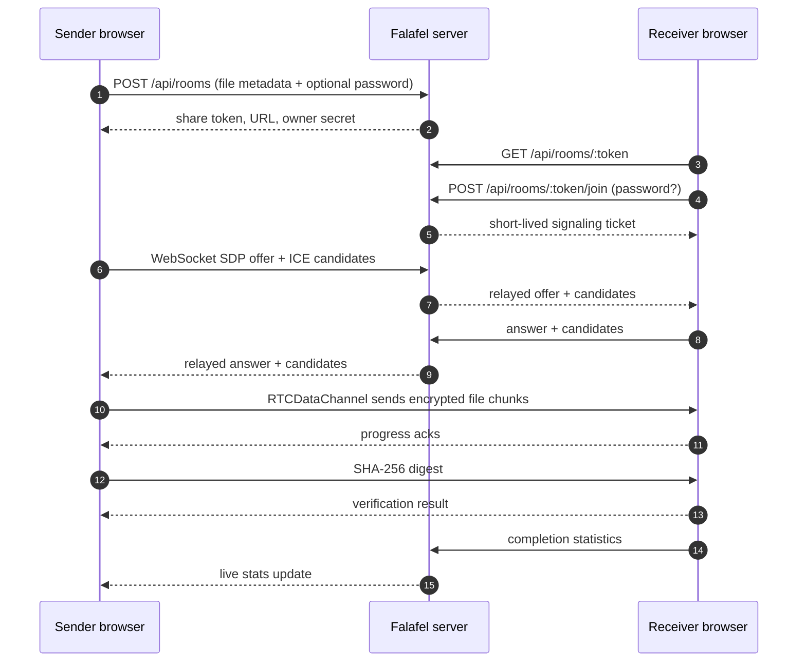

# Falafel

**Send a file. It goes straight to the other browser.**

Falafel sends a file from one browser to another over WebRTC. Pick a file, protect it with an optional password, and share one link. The Go server relays the connection details, keeps room metadata in SQLite, and never receives the file.

[](https://github.com/MahbodHastam/falafel/actions/workflows/ci.yml)
[](https://go.dev)
[](https://vuejs.org)
[](LICENSE)

## Why another file sender?

Most simple file transfer tools upload the file to a server and hand the receiver a download link. Falafel doesn't. The browsers connect directly over an encrypted WebRTC channel; the link stops working when the sender closes the tab.

## Features

- Direct transfer over an ordered, reliable `RTCDataChannel` with backpressure.
- No uploads. The server stores room metadata only.
- Optional password per room, hashed with argon2id.
- Owner dashboard with pending, completed, and wrong-password counts.
- Five wrong passwords trigger a cooldown.
- SHA-256 check before the receiver saves the file.
- Links end when the sender closes the tab, after a transfer, or after 24 hours.
- Files over 256 MiB stream to disk when the File System Access API is available.
- One binary with the client embedded.

## How it works



1. The sender picks a file. The browser reads it but never uploads it.
2. The Go server creates a random room token, stores the file metadata and password hash, and returns a share URL plus an owner secret.
3. The receiver opens the link, unlocks it if needed, and receives a short-lived HMAC-signed ticket.
4. Both browsers connect to the room's WebSocket. The server relays SDP and ICE messages without looking at file content.
5. A direct data channel opens. The sender streams 64 KiB chunks, respecting `bufferedAmount` backpressure.
6. The receiver acknowledges bytes for progress, verifies the SHA-256 digest, and saves the file.

### What the server stores

Room metadata only: file name, size, MIME type, argon2id password hash, status, attempt counters, byte progress, timestamps, and the activity log. There is no route that accepts file bytes. The SQLite database can be deleted at any time without losing any file.

## Tech stack

| Layer      | Choice                                                              |
| ---------- | ------------------------------------------------------------------- |
| Backend    | Go 1.26, `net/http`, `coder/websocket`, `log/slog`                   |
| Database   | SQLite via `modernc.org/sqlite` (pure Go, no CGO)                    |
| Frontend   | Vue 3.5 + TypeScript, Vue Router, vue-i18n                           |
| Styling    | Tailwind CSS 4                        |
| Transport  | WebRTC (`RTCPeerConnection`, `RTCDataChannel`), WebSocket signaling  |
| Crypto     | argon2id passwords, HMAC-signed tickets, SHA-256 file digests        |
| Tooling    | Vite, Vitest, Playwright, Docker, GitHub Actions                     |

## Quick start

Requirements: **Go 1.26+**, **Node.js 20.19+ (or 22.12+ / 24+)**, **pnpm 10+**.

```bash
git clone https://github.com/MahbodHastam/falafel.git
cd falafel
make install
make dev
```

- Web client: http://localhost:5173 (Vite proxies `/api` and WebSockets to the Go server)
- API: http://localhost:8080

Open two browser tabs or two browsers: send a file in one, paste the generated link in the other. WebRTC works on `localhost` without HTTPS.

To run the production build as a single binary:

```bash
make build
./bin/falafel
# http://localhost:8080
```

## Configuration

All configuration is read from the environment. Defaults work for local development.

| Variable                    | Default                       | Description                                                        |
| --------------------------- | ----------------------------- | ------------------------------------------------------------------ |
| `FALAFEL_ADDR`              | `:8080`                       | HTTP listen address.                                               |
| `FALAFEL_DB_PATH`           | `./data/falafel.db`           | SQLite file; its directory is created automatically.                |
| `FALAFEL_BASE_URL`          | *(derived from request)*      | Public URL used to build share links, e.g. `https://falafel.example.com`. |
| `FALAFEL_ROOM_TTL`          | `24h`                         | Lifetime of a waiting room.                                         |
| `FALAFEL_OWNER_GRACE`       | `10s`                         | How long a room survives after the sender disconnects.               |
| `FALAFEL_RETENTION`         | `168h`                        | How long closed/expired room metadata is kept before purging.        |
| `FALAFEL_MAX_FILE_SIZE`     | `10737418240` (10 GiB)        | Metadata limit enforced by the API.                                 |
| `FALAFEL_MIN_PASSWORD_LENGTH` | `4`                         | Minimum password length.                                            |
| `FALAFEL_STUN_URLS`         | `stun:stun.cloudflare.com:3478,stun:stun.l.google.com:19302` | Comma-separated STUN servers delivered to browsers. |
| `FALAFEL_TURN_URLS`         | *(empty)*                     | Comma-separated TURN server URLs (UDP/TCP/TLS).                      |
| `FALAFEL_TURN_USERNAME`     | *(empty)*                     | TURN username.                                                      |
| `FALAFEL_TURN_CREDENTIAL`   | *(empty)*                     | TURN credential.                                                    |
| `FALAFEL_SECRET`            | *(generated and persisted)*   | Base64url HMAC key (≥16 bytes) for download tickets.                |
| `FALAFEL_TRUST_PROXY`       | `false`                       | Trust `X-Forwarded-Proto`, `X-Forwarded-Host`, and `X-Forwarded-For`. |

See [`.env.example`](.env.example) for a copy-paste template.

## Tests

```bash
make test          # Go tests + Vitest
make test-go
make test-web
make e2e           # builds the app, then runs Playwright
```

- **Go**: room lifecycle, password verification, ticket tampering, HTTP validation, rate limiting, WebSocket relay, owner disconnect, downloader completion, SPA fallback.
- **Vitest**: i18n key/placeholder parity, formatting, transfer protocol parsing, password field behavior, sender chunking/backpressure with a fake data channel.
- **Playwright**: real two-browser transfers, password retry + owner statistics, sender-close → 404, unknown link, language persistence.

The Playwright suite lives in `web/e2e/`.

## Deployment

Falafel needs a **secure context** in production: serve it over HTTPS (or localhost) so WebRTC, `crypto.subtle`, and the clipboard API are available.

### Docker Compose

```bash
cp .env.example .env
# set FALAFEL_BASE_URL=https://falafel.example.com
docker compose up -d --build
```

The container listens on `127.0.0.1:8080`'s host port mapping and persists SQLite under the `falafel-data` volume.

### TLS with Caddy

[Caddyfile.example](Caddyfile.example) is a minimal reverse proxy with automatic HTTPS and WebSocket support:

```caddyfile
falafel.example.com {
	encode zstd gzip
	reverse_proxy 127.0.0.1:8080
	header {
		Strict-Transport-Security "max-age=31536000; includeSubDomains"
		-Server
	}
}
```

Set `FALAFEL_TRUST_PROXY=true` when running behind Caddy or another reverse proxy so links use the public scheme and host.

### Networks and TURN

STUN handles most consumer networks. Symmetric NATs or restrictive firewalls may need a TURN relay. Falafel works without one and ships with TURN disabled by default. If you add TURN, it relays encrypted DTLS packets. The TURN server cannot read file contents, and Falafel still never stores them.

## Security and privacy

- **No file storage.** There is no upload endpoint. The server cannot read transferred files.
- **Encrypted transport.** WebRTC data channels use DTLS; SDP/ICE signaling requires TLS in production.
- **Passwords.** argon2id with a random salt (`m=64 MiB, t=2, p=1`). Password hashes are never returned by the API.
- **Tokens.** 128-bit share tokens, 256-bit owner secrets (stored as SHA-256 hashes), and HMAC-signed download tickets with a two-minute lifetime.
- **Rate limiting.** Join attempts are limited per IP and token; room creation is limited per IP. Rate-limit state lives in memory only.
- **Privacy.** The app does not persist IP addresses or user agents. Activity entries contain event types and timestamps; file metadata is purged after the retention window.
- **Headers.** Strict CSP, `nosniff`, `frame-ancestors 'none'`, and a same-origin WebSocket origin check.
- **Verification.** The receiver checks the file size and SHA-256 digest before saving and reports the result to the sender.

## Adding a language

Add a locale file in `web/src/i18n/`, register it in `web/src/i18n/index.ts`, and keep the keys and `{placeholders}` in sync. The i18n unit test fails on missing or mismatched keys.

## Limitations

- One file and one active receiver per link; no multi-file queues or resume.
- The sender's tab must stay open while the receiver downloads. Reloading it ends the session.
- No rendezvous after completion: a used link returns 404.
- In-memory Blob assembly is used on browsers without the File System Access API, which limits very large downloads by available memory.
- Signaling and SQLite are single-node; horizontal scaling would need sticky WebSocket routing.

## License

[MIT](LICENSE).
