# Falafel

**Send a file. It goes straight to the other browser.**

Falafel sends a file from one browser to another over WebRTC. Pick a file, protect it with an optional password, and share one link. The Go server relays the connection details, keeps room metadata in SQLite, and never receives the file. Read [Security and privacy](#security-and-privacy) for exactly what that does and does not promise.

[](https://github.com/MahbodHastam/falafel/actions/workflows/ci.yml)
[](https://go.dev)
[](https://vuejs.org)
[](LICENSE)

## Why another file sender?

Most simple file transfer tools upload the file to a server and hand the receiver a download link. Falafel doesn't. The browsers connect directly over an encrypted WebRTC channel, and the link stops working when the sender closes the tab. You can run your own server from a single binary or container.

## Features

- Direct transfer over an ordered, reliable `RTCDataChannel` with backpressure.
- No uploads. The server stores room metadata only.
- Optional password per room, hashed with argon2id.
- Owner dashboard with pending, completed, and wrong-password counts.
- Five wrong passwords trigger a cooldown.
- SHA-256 check before the receiver saves the file.
- The share link carries a random key in its `#fragment`. Each browser proves it holds that key by authenticating the other's DTLS fingerprint, so a malicious signaling server cannot sit in the middle.
- Flow control: the sender never runs more than 32 MiB ahead of what the receiver has written to disk.
- The sender's WebSocket reconnects after a brief network drop without ending the transfer.
- Links end when the sender closes the tab, after a transfer, or after 24 hours.
- Files over 256 MiB stream to disk when the File System Access API is available.
- One binary with the client embedded.

## How it works

```mermaid
sequenceDiagram
    autonumber
    participant Sender as Sender browser
    participant Server as Falafel server
    participant Receiver as Receiver browser

    Sender->>Server: POST /api/rooms (file metadata + optional password)
    Server-->>Sender: share token, URL, owner secret
    Note over Sender: adds a random key to the URL as #k=... (never sent to the server)
    Receiver->>Server: GET /api/rooms/:token
    Receiver->>Server: POST /api/rooms/:token/join (password?)
    Server-->>Receiver: short-lived signaling ticket
    Sender->>Server: WebSocket SDP offer + ICE candidates
    Server-->>Receiver: relayed offer + candidates
    Receiver->>Server: answer + candidates
    Server-->>Sender: relayed answer + candidates
    Sender->>Receiver: channel opens: HMAC(key, DTLS fingerprints)
    Receiver-->>Sender: HMAC(key, DTLS fingerprints)
    Sender->>Receiver: RTCDataChannel sends encrypted file chunks
    Receiver-->>Sender: progress acks
    Sender->>Receiver: SHA-256 digest
    Receiver-->>Sender: verification result
    Receiver->>Server: completion statistics
    Server-->>Sender: live stats update
```



1. The sender picks a file. The browser reads it but never uploads it.
2. The Go server creates a random room token, stores the file metadata and password hash, and returns a share URL plus an owner secret. The sender's browser appends a random key to the URL as `#k=…`. Browsers never send the fragment to a server.
3. The receiver opens the link, unlocks it if needed, and receives a short-lived HMAC-signed ticket.
4. Both browsers connect to the room's WebSocket. The server relays SDP and ICE messages without looking at file content.
5. A direct data channel opens. Before any file byte moves, each side sends an HMAC, keyed with the link key, over the two DTLS fingerprints it sees. A mismatch means the signaling path was tampered with, and the transfer stops.
6. The sender streams 64 KiB chunks, respecting `bufferedAmount` and the receiver's acknowledgements.
7. The receiver acknowledges bytes as they reach disk, verifies the SHA-256 digest, and saves the file.

### What the server stores

Room metadata only: file name, size, MIME type, argon2id password hash, status, attempt counters, byte progress, timestamps, and the activity log. There is no route that accepts file bytes. The SQLite database can be deleted at any time without losing any file.

## Tech stack

| Layer      | Choice                                                              |
| ---------- | ------------------------------------------------------------------- |
| Backend    | Go 1.26, `net/http`, `coder/websocket`, `log/slog`                   |
| Database   | SQLite via `modernc.org/sqlite` (pure Go, no CGO)                    |
| Frontend   | Vue 3.5 + TypeScript, Vue Router, vue-i18n                           |
| Styling    | Tailwind CSS 4                                                      |
| Transport  | WebRTC (`RTCPeerConnection`, `RTCDataChannel`), WebSocket signaling  |
| Crypto     | argon2id passwords, HMAC-signed tickets, link-key channel binding, SHA-256 file digests |
| Tooling    | Vite, Vitest, Playwright, Docker, GitHub Actions                     |

## Install

- **Binary:** download the archive for your platform from [Releases](https://github.com/MahbodHastam/falafel/releases), check it against `SHA256SUMS`, and run `./falafel`. Run `./falafel -version` to see the build.
- **Container:** `docker run -p 127.0.0.1:8080:8080 -v falafel-data:/data ghcr.io/mahbodhastam/falafel:latest`
- **From source:** see below.

## Quick start

Requirements: **Go 1.26+**, **Node.js 20.19+ (or 22.12+ / 24+)**, **pnpm 10+**.

```bash
git clone https://github.com/MahbodHastam/falafel.git
cd falafel
make install
make dev
```

- Web client: http://localhost:5173 (Vite proxies `/api` and WebSockets to the Go server)
- API: http://localhost:8080

Open two browser tabs or two browsers: send a file in one, paste the generated link in the other. WebRTC works on `localhost` without HTTPS.

To run the production build as a single binary:

```bash
make build
./bin/falafel
# http://localhost:8080
```

## Configuration

All configuration is read from the environment. Defaults work for local development.

| Variable                    | Default                       | Description                                                        |
| --------------------------- | ----------------------------- | ------------------------------------------------------------------ |
| `FALAFEL_ADDR`              | `:8080`                       | HTTP listen address.                                               |
| `FALAFEL_DB_PATH`           | `./data/falafel.db`           | SQLite file; its directory is created automatically.                |
| `FALAFEL_BASE_URL`          | *(derived from request)*      | Public URL used to build share links, e.g. `https://falafel.example.com`. |
| `FALAFEL_ROOM_TTL`          | `24h`                         | Lifetime of a waiting room.                                         |
| `FALAFEL_OWNER_GRACE`       | `10s`                         | How long a room survives after the sender disconnects.               |
| `FALAFEL_RETENTION`         | `168h`                        | How long closed/expired room metadata is kept before purging.        |
| `FALAFEL_MAX_FILE_SIZE`     | `10737418240` (10 GiB)        | Metadata limit enforced by the API.                                 |
| `FALAFEL_MIN_PASSWORD_LENGTH` | `4`                         | Minimum password length.                                            |
| `FALAFEL_STUN_URLS`         | `stun:stun.cloudflare.com:3478,stun:stun.l.google.com:19302` | Comma-separated STUN servers delivered to browsers. |
| `FALAFEL_TURN_URLS`         | *(empty)*                     | Comma-separated TURN server URLs (UDP/TCP/TLS).                      |
| `FALAFEL_TURN_SECRET`       | *(empty)*                     | Shared secret for coturn's `use-auth-secret`. Falafel issues each browser TURN credentials that expire with the room. Preferred over the two static options below. |
| `FALAFEL_TURN_USERNAME`     | *(empty)*                     | Static TURN username. Served to every visitor of `/api/config`.      |
| `FALAFEL_TURN_CREDENTIAL`   | *(empty)*                     | Static TURN credential. Served to every visitor of `/api/config`.    |
| `FALAFEL_SECRET`            | *(generated and persisted)*   | Base64url HMAC key (≥16 bytes) for download tickets.                |
| `FALAFEL_TRUST_PROXY`       | `false`                       | Trust `X-Forwarded-Proto`, `X-Forwarded-Host`, and `X-Forwarded-For` (last entry). Enable only when a reverse proxy is the sole way to reach the server. |

See [`.env.example`](.env.example) for a copy-paste template.

## Tests

```bash
make test          # Go tests + Vitest
make test-go
make test-web
make e2e           # builds the app, then runs Playwright
```

- **Go**: room lifecycle, password verification and its concurrency cap, ticket tampering and expiry, HTTP validation, client-IP and rate-limit handling, security headers, TURN credentials, schema migrations, WebSocket relay, owner reconnect, downloader completion, SPA fallback.
- **Vitest**: i18n key/placeholder parity, formatting, transfer protocol parsing, link-key channel authentication (including a swapped fingerprint), sender chunking and flow control, receiver integrity checks, file-name sanitising.
- **Playwright**: real two-browser transfers, password retry + owner statistics, a link with its key stripped, sender-close → 404, unknown link, language persistence.

The Playwright suite lives in `web/e2e/`.

## Deployment

Falafel needs a **secure context** in production: serve it over HTTPS (or localhost) so WebRTC, `crypto.subtle`, and the clipboard API are available.

### Docker Compose

```bash
cp .env.example .env
# set FALAFEL_BASE_URL=https://falafel.example.com
docker compose up -d --build
```

The container publishes port 8080 on `127.0.0.1` only, so put a reverse proxy in front of it. The compose file therefore defaults `FALAFEL_TRUST_PROXY` to `true`. SQLite lives in the `falafel-data` volume, and the container runs read-only as an unprivileged user. Every setting in the table above can go in `.env`.

### TLS with Caddy

[Caddyfile.example](Caddyfile.example) is a minimal reverse proxy with automatic HTTPS and WebSocket support:

```caddyfile
falafel.example.com {
	encode zstd gzip
	reverse_proxy 127.0.0.1:8080
	header {
		Strict-Transport-Security "max-age=31536000; includeSubDomains"
		-Server
	}
}
```

Set `FALAFEL_TRUST_PROXY=true` when running behind Caddy or another reverse proxy so links use the public scheme and host and rate limits see real client addresses. Do that only if the proxy is the sole way to reach Falafel; otherwise clients can forge `X-Forwarded-For`.

### Networks and TURN

STUN handles most consumer networks. Symmetric NATs or restrictive firewalls may need a TURN relay. Falafel works without one and ships with TURN disabled by default. A TURN server relays encrypted DTLS packets; it cannot read file contents.

Configure coturn with `use-auth-secret` and `static-auth-secret=<secret>`, then set `FALAFEL_TURN_URLS` and the same value in `FALAFEL_TURN_SECRET`. Falafel hands each browser credentials that expire with the room. Static `FALAFEL_TURN_USERNAME` and `FALAFEL_TURN_CREDENTIAL` also work, but `/api/config` shows them to everyone, so anybody can use your relay.

## Security and privacy

### Threat model

What Falafel protects, assuming you run unmodified code:

- **File contents** travel over a DTLS-encrypted data channel between the two browsers. There is no upload endpoint, so the server never holds the bytes.
- **A malicious or compromised signaling server** cannot read or alter the transfer undetected. It relays the SDP, so it could swap DTLS fingerprints and sit in the middle, but the browsers authenticate the fingerprints with a key from the link's `#fragment`, which the server never receives. Whoever holds the full link can receive the file. A link whose fragment was stripped is refused.
- **Guessing links or passwords** is limited by 128-bit tokens, argon2id hashing, and per-address rate limits.

What it does not protect:

- **Anyone who gets the full link** (including the fragment) can fetch the file, subject to the password if one is set. The password gates the signaling ticket; it does not encrypt anything. Share the link over a channel you trust.
- **The operator can see metadata**: file name, size, MIME type, timing, and (in proxy logs) IP addresses. Falafel itself does not persist IPs or user agents.
- **A malicious operator could serve modified JavaScript** to the browser, as with any web app. Self-host if you do not trust the host.
- **Availability.** The server can refuse or drop connections.

### Details

- **Passwords.** argon2id with a random salt (`m=64 MiB, t=2, p=1`), never returned by the API. At most four hashes run at once, so a burst of requests cannot exhaust memory.
- **Tokens.** 128-bit share tokens, 256-bit owner secrets (stored as SHA-256 hashes, compared in constant time), and HMAC-signed signaling tickets with a two-minute lifetime. Share tokens are never written to logs.
- **Rate limiting.** Five wrong passwords per address and link trigger a 60 second block; room creation is limited to 30 per hour per address. IPv6 clients are limited by /64. State lives in memory only.
- **Headers.** `Content-Security-Policy` without `unsafe-inline` and with the WebSocket origin named explicitly, `Referrer-Policy: no-referrer`, `nosniff`, `frame-ancestors 'none'`, and a same-origin WebSocket origin check.
- **File names** are shown and saved after stripping path separators, control and direction-override characters, and Windows reserved names.
- **Verification.** The receiver checks the file size and SHA-256 digest before saving and reports the result to the sender.

Report vulnerabilities privately; see [SECURITY.md](SECURITY.md).

## Adding a language

Add a locale file in `web/src/i18n/`, register it in `web/src/i18n/index.ts`, and keep the keys and `{placeholders}` in sync. The i18n unit test fails on missing or mismatched keys.

## Limitations

- One file and one active receiver per link; no multi-file queues or resume.
- The sender's tab must stay open while the receiver downloads. Reloading it ends the session. A brief network drop does not: the socket reconnects within the owner grace period.
- No rendezvous after completion: a used link returns 404.
- Browsers without the File System Access API (Firefox, Safari) assemble the file as a Blob. Large files then depend on the browser spilling Blobs to disk, so very large downloads can still exhaust memory there. Chromium browsers stream files of 256 MiB and up straight to disk.
- Empty files cannot be sent.
- Signaling and SQLite are single-node; horizontal scaling would need sticky WebSocket routing.

## Contributing

Bug reports and pull requests are welcome. See [CONTRIBUTING.md](CONTRIBUTING.md) for the dev loop and what makes a change easy to merge, and [CHANGELOG.md](CHANGELOG.md) for release notes.

## License

[MIT](LICENSE).
